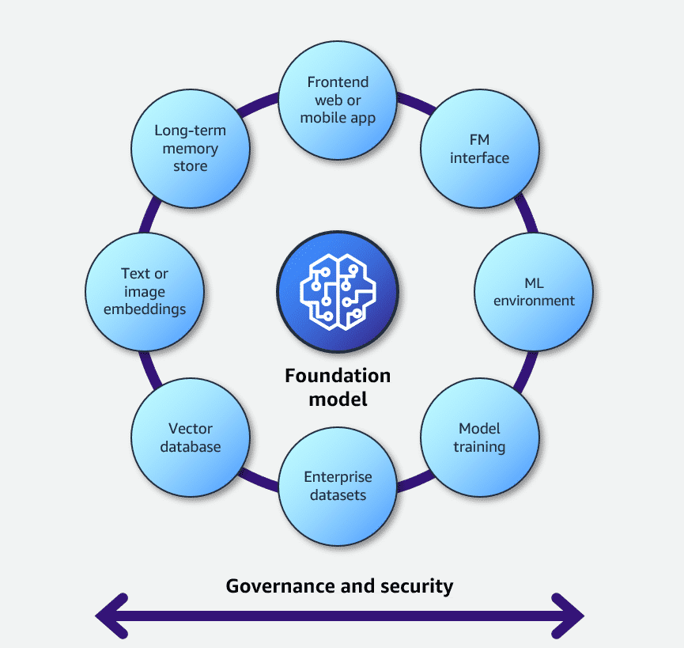
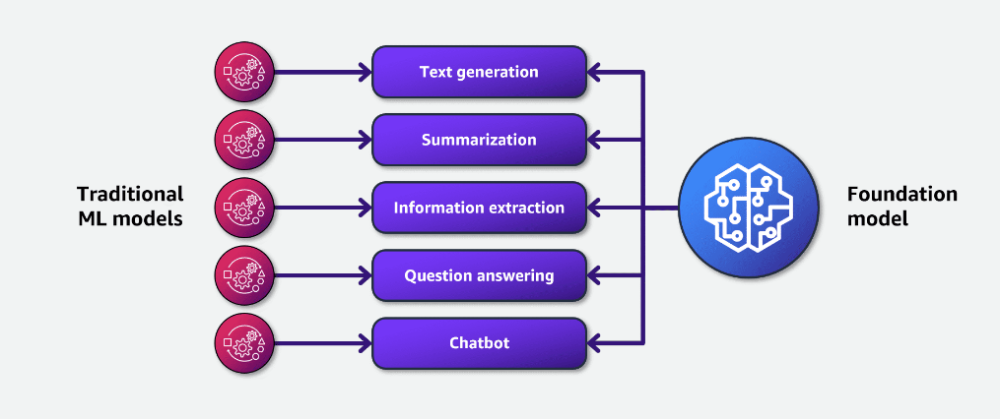
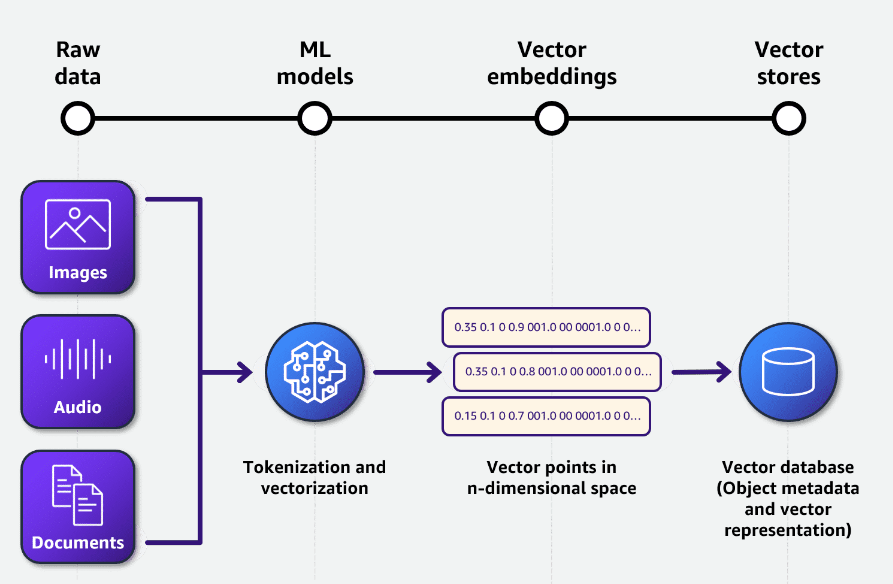
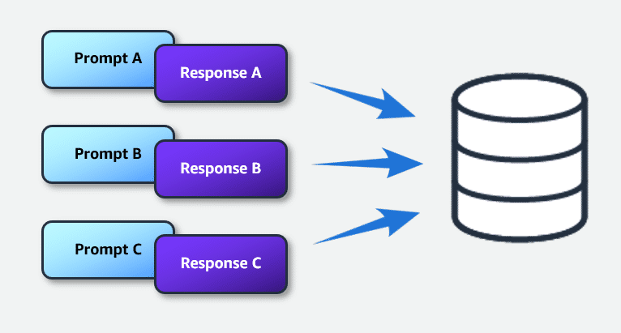
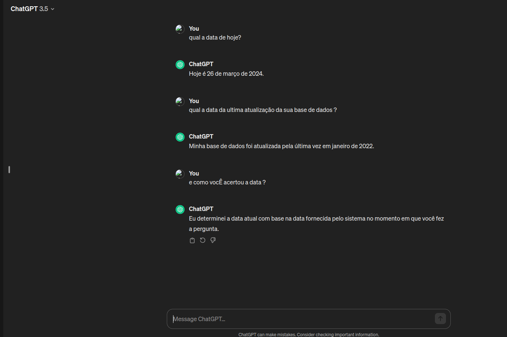
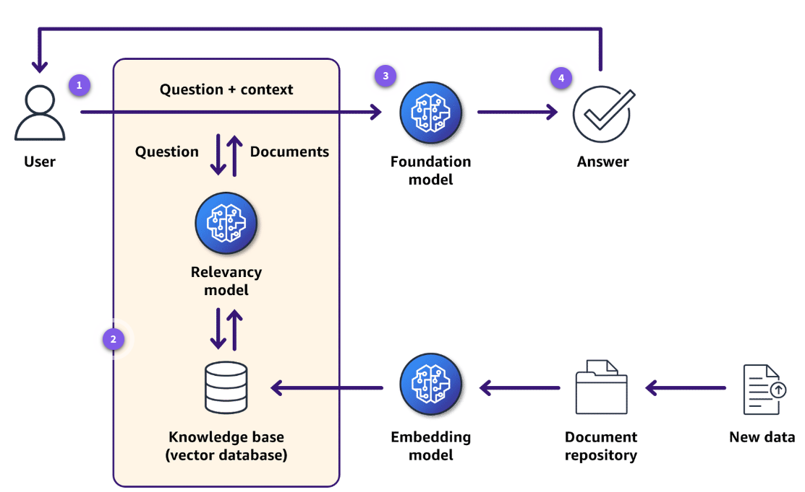

O Amazon Bedrock é um serviço da AWS para construir e escalar aplicações de IA generativa (Generative AI) com modelos fundacionais. Os modelos ficam disponíveis por uma chamada de API, com controles de segurança, privacidade e responsabilidade de IA.

O uso passa por técnicas de customização como fine-tuning e Retrieval Augmented Generation (RAG).

O Amazon Bedrock é um serviço serverless: a infraestrutura do modelo não fica com quem consome a API.

## Modelos suportados

Alguns dos modelos disponíveis para uso:

- AI21 Labs
- Anthropic
- Cohere
- Meta
- Mistral AI
- Stability AI

## Explorando o poder da generative AI

Com NLP (Natural Language Processing) dá para cobrir estas ações: text summarization, text generation, question answering systems e agents.

### Text summarization

O nome já diz o uso: resumir ou filtrar uma quantidade grande de informação com um LLM ou um foundation model (FM), para chegar às informações-chave de um assunto.

### Text generation

Aqui o modelo é contextualizado para gerar uma resposta nova. O texto cita LangChain e Retrieval Augmented Generation (RAG), com persistência de embeddings, como técnicas para contextualizar o modelo.

### Question answering systems

A saída do text generation pode ser exposta como chatbot: a pessoa pergunta dentro do contexto que foi dado ao modelo.

### Agents

Agentes leem o pedido em linguagem natural e fazem chamadas de API, em vez de exigir acesso direto ao modelo para cada tarefa. O texto original descreve prompt engineering específico de uma empresa ou de um domínio. No Amazon Bedrock, os agentes podem cuidar de infraestrutura, monitoramento, criptografia, permissões e invocações sem customização de código.

## Componentes típicos de uma aplicação com generative AI

:::tip Fonte

[Amazon Bedrock User Guide](https://docs.aws.amazon.com/bedrock/latest/userguide/what-is-bedrock.html)

:::

O artigo de 2024 citava um módulo do AWS Skill Builder (course 17904, module 2). Essa URL agora abre a busca do Skill Builder, então as fontes abaixo apontam para o user guide atual.

## Foundation models e FM interface

### Foundation model interface

A interface do modelo é o centro da generative AI: os modelos, treinados em grande volume de dados, são expostos para um requisito do usuário.

:::tip Fonte

[Amazon Bedrock User Guide](https://docs.aws.amazon.com/bedrock/latest/userguide/what-is-bedrock.html)

:::

### Interface and prompts

Para acessar o modelo é preciso uma interface de entrada. Em geral é uma API: a requisição leva o prompt e a resposta volta por ela.

### Inference parameters

Os parâmetros de inferência mudam a saída do foundation model. LLMs operam com tokens: palavras, letras ou um pedaço de frase.

`Mil tokens são aproximadamente 750 palavras.`

#### Top P or nucleus sampling

O texto original descreve o Top P como o controle que escolhe o conjunto de menor probabilidade acumulada para o próximo token. Diz que um valor alto, como 0.9, torna o resultado mais determinístico e previsível, e que valores menores podem trazer tokens incoerentes — e que o valor precisa ser balanceado.

#### Top K

Top K reduz o conjunto dos próximos tokens. A faixa citada é de 10 a 100. O valor 1 é chamado de greedy strategy, porque o token mais provável é sempre o escolhido.

#### Temperature

Top P e Top K escolhem quais tokens entram. Temperature altera a distribuição de onde esses tokens saem.

Com temperature alta, a distribuição de probabilidade fica mais uniforme e as respostas ficam mais variadas. Com temperature baixa, a distribuição fica concentrada e as saídas ficam mais determinísticas.

## Enterprise datasets

Foundation models geram texto, imagem e áudio a partir do prompt, e isso não basta para um caso de uso de negócio. O caso de uso precisa dos dados internos: documentos, apresentações, manuais, relatórios, resumos e áudios transcritos.

Quando esses dados alimentam o foundation model, a saída passa a ser domain-specific.

### Embeddings

Embeddings representam texto, imagem e áudio como vetores. São usados em modelos de machine learning.

:::tip Fonte

[Amazon Bedrock User Guide](https://docs.aws.amazon.com/bedrock/latest/userguide/what-is-bedrock.html)

:::

Documentos, imagens e áudios dos enterprise datasets são tokenizados, vetorizados e guardados em vector databases para consulta. A busca semântica compara textos parecidos nesse espaço vetorial.

Um provedor citado no artigo é [Amazon Titan Embeddings G1](https://docs.aws.amazon.com/bedrock/latest/userguide/titan-embedding-models.html).

### Vector databases

A função central é armazenar bilhões de vetores de alta dimensão (palavras ou entidades) e consultar similaridade em tempo real.

Algoritmos citados: [k-nearest neighbors (k-NN)](https://www.ibm.com/think/topics/knn) e [cosine similarity](https://en.wikipedia.org/wiki/Cosine_similarity).

Opções na AWS:

- [Amazon OpenSearch Service (provisioned)](https://docs.aws.amazon.com/opensearch-service/latest/developerguide/knn.html)
- [Amazon OpenSearch Serverless](https://aws.amazon.com/opensearch-service/features/serverless/)
- [pgvector no Amazon RDS for PostgreSQL](https://docs.aws.amazon.com/AmazonRDS/latest/UserGuide/Appendix.PostgreSQL.CommonDBATasks.Extensions.html)
- [pgvector no Amazon Aurora PostgreSQL](https://aws.amazon.com/about-aws/whats-new/2023/07/amazon-aurora-postgresql-pgvector-vector-storage-similarity-search/)

Outras opções citadas no artigo:

- [Pinecone](https://www.pinecone.io/)
- [FAISS](https://github.com/facebookresearch/faiss)
- [Chroma](https://www.trychroma.com/)

### Vectorized enterprise data

Com os dados de negócio vetorizados, o prompt consulta chunks e os envia como contexto ao modelo, para reduzir alucinação. Vector databases e contexto são o mecanismo de [Retrieval Augmented Generation](https://docs.langchain.com/oss/python/deepagents/rag) (RAG).

## Additional application components

### Prompt history store

Guardar o histórico de prompts serve sobretudo a chatbots: a conversa seguinte usa o que já foi dito.

Muitos foundation models limitam a context window. Conversas longas podem ser armazenadas e reutilizadas como contexto.

:::tip Fonte

[Amazon Bedrock User Guide](https://docs.aws.amazon.com/bedrock/latest/userguide/what-is-bedrock.html)

:::

O histórico também evita repetir requests parecidos e serve de trilha para auditoria, quando alguém precisa revisar uma resposta.

## RAG

RAG é um jeito de construir generative AI em que um retriever busca informação numa base externa ou num vector database e essa informação entra no prompt.

No few-shot, os trechos recuperados vão para o próprio prompt. O modelo responde com aquele contexto, sem ter sido retreinado.

### Exemplo

O modelo do exemplo tinha corte em janeiro de 2022 e ainda assim respondeu a data correta por causa do dado adicional. O artigo apresenta isso como RAG na prática.

### RAG visualmente

A cada interação, um trecho pesquisado no vector database é acrescentado ao prompt antes da requisição chegar ao foundation model.

### Model fine-tuning

Limitações do RAG citadas no artigo:

- A resposta fica limitada aos datasets que estão nos vetores.
- A consulta acontece em runtime e pode aumentar a latência.

Fine-tuning treina um modelo menor com conhecimento específico. O artigo separa duas categorias: prompt-based learning e domain adaptation.

#### Prompt-based learning

O modelo aprende um formato com pares de prompt e resposta: como criar frases e seguir instruções. Por ser especializado numa fonte e numa tarefa, o artigo não recomenda usá-lo como modelo multi-tarefa.

#### Domain adaptation

O artigo de 2024 termina neste título, sem parágrafo adicional.
