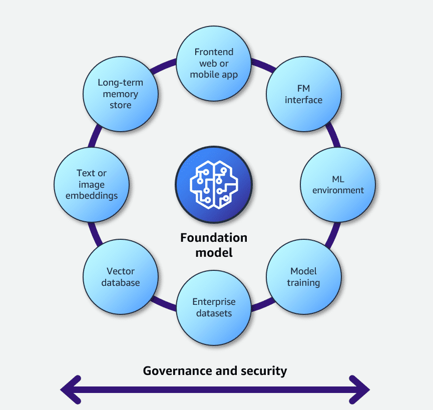
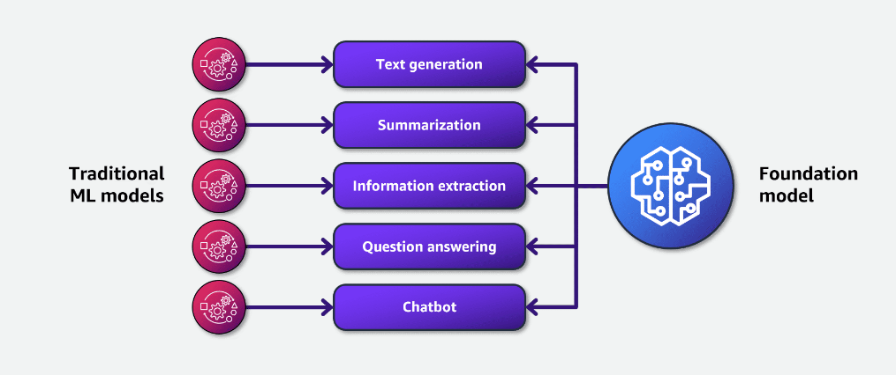
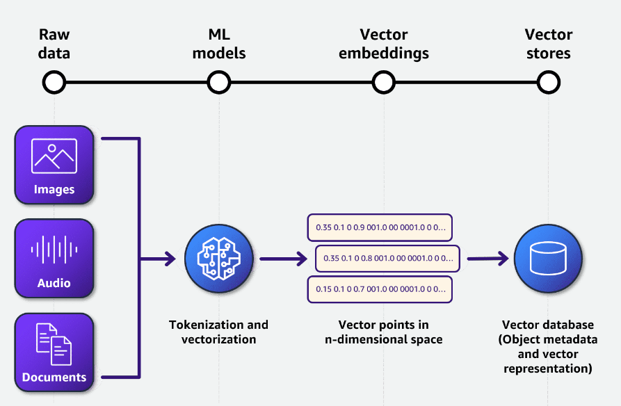
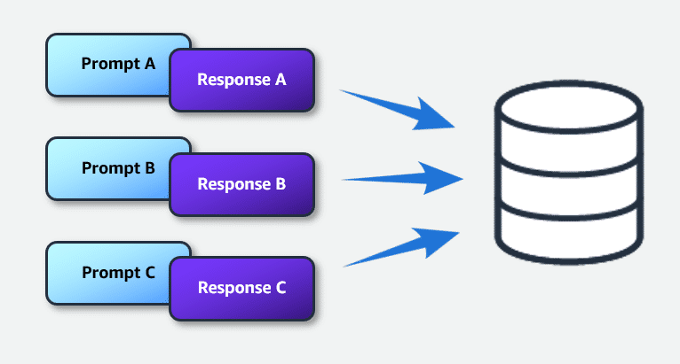
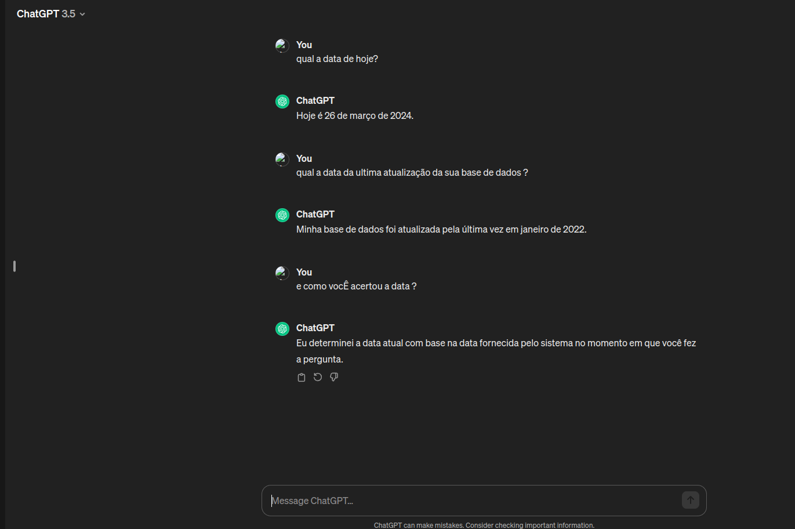
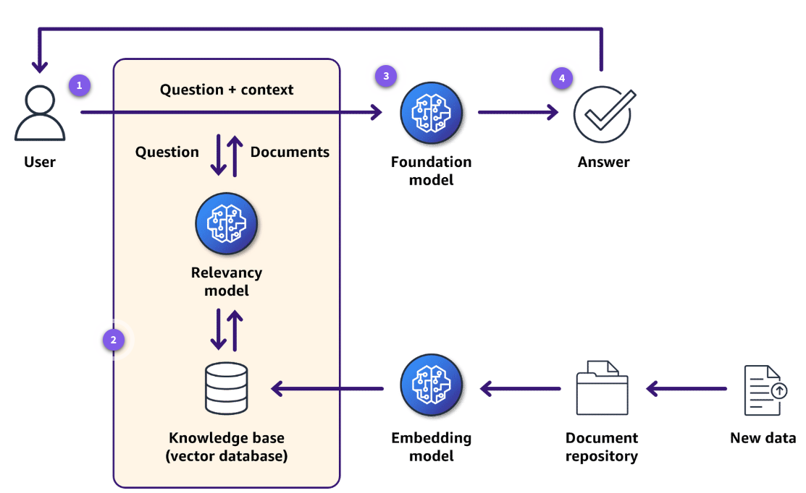

Amazon Bedrock is an AWS service for building and scaling generative AI applications on foundation models. The models are available through an API call, with security, privacy, and responsible-AI controls.

Customization in the article is fine-tuning and Retrieval Augmented Generation (RAG).

Amazon Bedrock is serverless: the caller does not run the model infrastructure.

This is the English text of the article published on 20 Mar 2024. The claims below follow that article, including where a parameter description is loose.

## Supported models

Some of the models listed for use:

- AI21 Labs
- Anthropic
- Cohere
- Meta
- Mistral AI
- Stability AI

## What generative AI is used for here

With NLP, the article covers four actions: text summarization, text generation, question answering systems, and agents.

### Text summarization

Summarize or filter a large amount of information with an LLM or a foundation model (FM), and keep the key points of a subject.

### Text generation

The model is given context so it can produce a new answer. The article names LangChain and Retrieval Augmented Generation (RAG), with persisted embeddings, as the way to contextualize the model.

### Question answering systems

The text-generation output can be exposed as a chatbot: a person asks inside the context that was given to the model.

### Agents

Agents read a natural-language request and issue API calls, instead of requiring direct model access for every task. The original text describes company-specific or domain-specific prompt engineering. On Amazon Bedrock, agents can handle infrastructure, monitoring, encryption, permissions, and invocations without custom code.

## Typical components of a generative AI application

:::tip Source

[Amazon Bedrock User Guide](https://docs.aws.amazon.com/bedrock/latest/userguide/what-is-bedrock.html)

:::

The 2024 article cited an AWS Skill Builder module (course 17904, module 2). That URL now opens Skill Builder search, so the sources below point at the current user guide.

## Foundation models and the FM interface

### Foundation model interface

The model interface is the center of generative AI: models trained on a large body of data are exposed for a user requirement.

:::tip Source

[Amazon Bedrock User Guide](https://docs.aws.amazon.com/bedrock/latest/userguide/what-is-bedrock.html)

:::

### Interface and prompts

Reaching the model takes an input interface. It is usually an API: the request carries the prompt and the response comes back on it.

### Inference parameters

Inference parameters change the foundation model output. LLMs operate on tokens: words, letters, or a piece of a phrase.

`One thousand tokens are about 750 words.`

#### Top P or nucleus sampling

The original article describes Top P as the control that picks the lowest cumulative probability set for the next token. It says a high value such as 0.9 makes the result more deterministic and predictable, and that lower values can surface incoherent tokens — and that the value has to be balanced.

#### Top K

Top K shrinks the set of next tokens. The range given is 10 to 100. The value 1 is called the greedy strategy, because the most likely token is always chosen.

#### Temperature

Top P and Top K choose which tokens are eligible. Temperature changes the distribution those tokens are drawn from.

With a high temperature, the probability distribution is more uniform and the answers vary more. With a low temperature, the distribution is peaked and the outputs are more deterministic.

## Enterprise datasets

Foundation models can generate text, images, and audio from a prompt, and that is not enough for a business use case. The use case needs internal data: documents, presentations, manuals, reports, summaries, and transcribed audio.

When that data is fed to the foundation model, the output becomes domain-specific.

### Embeddings

Embeddings represent text, images, and audio as vectors. They are used in machine learning models.

:::tip Source

[Amazon Bedrock User Guide](https://docs.aws.amazon.com/bedrock/latest/userguide/what-is-bedrock.html)

:::

Documents, images, and audio from the enterprise datasets are tokenized, vectorized, and stored in vector databases for lookup. Semantic search compares similar texts in that vector space.

One provider named in the article is [Amazon Titan Embeddings G1](https://docs.aws.amazon.com/bedrock/latest/userguide/titan-embedding-models.html).

### Vector databases

The core job is to store billions of high-dimensional vectors (words or entities) and query similarity in real time.

Algorithms named: [k-nearest neighbors (k-NN)](https://www.ibm.com/think/topics/knn) and [cosine similarity](https://en.wikipedia.org/wiki/Cosine_similarity).

AWS options:

- [Amazon OpenSearch Service (provisioned)](https://docs.aws.amazon.com/opensearch-service/latest/developerguide/knn.html)
- [Amazon OpenSearch Serverless](https://aws.amazon.com/opensearch-service/features/serverless/)
- [pgvector on Amazon RDS for PostgreSQL](https://docs.aws.amazon.com/AmazonRDS/latest/UserGuide/Appendix.PostgreSQL.CommonDBATasks.Extensions.html)
- [pgvector on Amazon Aurora PostgreSQL](https://aws.amazon.com/about-aws/whats-new/2023/07/amazon-aurora-postgresql-pgvector-vector-storage-similarity-search/)

Other options named in the article:

- [Pinecone](https://www.pinecone.io/)
- [FAISS](https://github.com/facebookresearch/faiss)
- [Chroma](https://www.trychroma.com/)

### Vectorized enterprise data

Once business data is vectorized, the prompt retrieves chunks and sends them as context to the model, to reduce hallucination. Vector databases plus context are the mechanism of [Retrieval Augmented Generation](https://docs.langchain.com/oss/python/deepagents/rag) (RAG).

## Additional application components

### Prompt history store

Storing prompt history matters most for chatbots: the next turn uses what was already said.

Many foundation models cap the context window. Long conversations can be stored and reused as context.

:::tip Source

[Amazon Bedrock User Guide](https://docs.aws.amazon.com/bedrock/latest/userguide/what-is-bedrock.html)

:::

The history also avoids repeating similar requests and gives an audit trail when someone has to review an answer.

## RAG

RAG is a way to build generative AI in which a retriever looks up an external base or a vector database and that information is placed in the prompt.

In the few-shot framing of the article, the retrieved passages go into the prompt itself. The model answers with that context, without being retrained.

### Example

The example model had a January 2022 cutoff and still answered the correct date because of the extra fact. The article presents that as RAG in practice.

### RAG, visually

On each turn, a passage retrieved from the vector database is appended to the prompt before the request reaches the foundation model.

### Model fine-tuning

RAG limits named in the article:

- The answer is limited to the datasets stored as vectors.
- The lookup happens at runtime and can add latency.

Fine-tuning trains a smaller model with specific knowledge. The article splits this into prompt-based learning and domain adaptation.

#### Prompt-based learning

The model learns a format from prompt/response pairs: how to form sentences and follow instructions. Because it is specialized to one source and one task, the article does not recommend it as a multi-task model.

#### Domain adaptation

The 2024 article ends on this heading, with no further paragraph.
